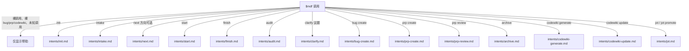

# Mars Development Flow

仅接受显式 `$mdf <intent>` 调用。裸 `$mdf` 只显示帮助。

## 选择树

## 工作流（唯一执行契约）

入口与各 intent 只按编号工作流执行；图示仅用于路由。

1. **约束**；只接受选择树所列的显式调用；`next [方向]` 的方向可省略，
   `clarify <议题>` 的议题由对应 intent 检查。不得因缺文档、代码/测试状态或对话上下文
   隐式选择 intent；证据：完整、非空的调用；通过 → 2；失败 → 仅展示意图表与调用示例，
   不读取 intent、不检查仓库、不写入。
2. **脚本**；将本文件所在目录的绝对路径设为 `MDF_ROOT`，确认 `scripts/mdf.py`，运行
   `python3 "$MDF_ROOT/scripts/mdf.py" info`；证据：三个版本均为数字 `2`；
   通过 → 3；失败 → 停止，不得模拟 CLI。
3. **约束**；完整读取选择树指定的 intent，并只按其按需读取说明读取公共引用；
   将调研、已确认决策与`当前事实文档`分开，不把候选方案当作已实现行为，
   不替代任务管理；按 intent 用 Markdown 与 `manifest` 留下可验证的演进记录，
   不自动提交工作区改动；仅 `finish-gitflow` 创建规定的 merge commit；
   证据：已读取材料与其流程结果；通过 → 执行 intent；
   失败 → 停止并报告缺失材料。

## 术语与数据结构

| 材料 | 位置 | 读取条件 |
| --- | --- | --- |
| 意图 | `intents/` | 读取显式调用命中的流程及其声明委托的内部流程 |
| 公共契约 | `references/` | 按 intent 指定读取目录、对象或 CodeWiki 契约 |
| 模板 | `assets/` | intent 要求写入仓库产出物时读取对应模板 |
| 确定性 CLI | `scripts/` | intent 要求确定性操作时调用 |

`$mdf bug <action>`、`$mdf prp <action>`、`$mdf codewiki <action>` 与
`$mdf jot promote` 均由选择树路由；这些内部材料不是独立 Skill。
CLI 形式为 `python3 "$MDF_ROOT/scripts/mdf.py" <command>`；command 与用户 intent
不要求一一对应。CLI 统一解析目标 Git 根，不假设当前目录就是目标仓库。
