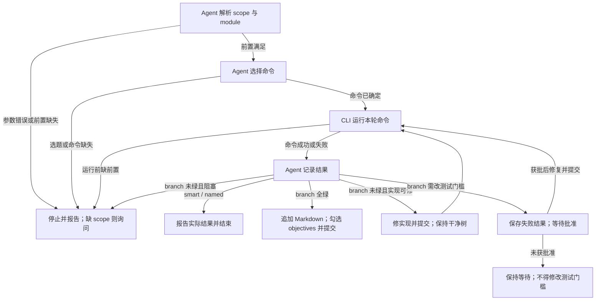

# verify 规则讲解示例

本页用文字与图解比较 scope；当前执行规则以 [verify intent](../../references/verify.md) 为准。

- 本页与 [交互 HTML](verify.html) 采用固定示例，不读取仓库、不运行验证。
- HTML 可用浏览器直接打开；先选择 scope，再切换交付类型，观察规则变化。
- 示例假设 modules 与所需命令已配置；是否具备真实前置条件须由 Agent 检查。
- 图解帮助理解规则，不构成验证结果或第二份执行契约。

## scope 对照

本节回答何时能执行、检查什么、留下什么证据。

| 项目 | smart | branch | named（固定 quick 示例） |
| --- | --- | --- | --- |
| 分支条件 | 交付分支 | 交付分支，执行前干净树 | 不要求交付分支 |
| module | `--module` / `--paths` 解析，集合非空 | 全部 module | 五固定入口由 modules 解析 |
| 检查 | lint/build/quick + Agent 选题 | lint/build/quick + 默认 suite | 已指定 quick，只跑 quick |
| suite | Agent 选择 test/testcase | feature/bugfix/hotfix → smoke；release → release | 不随交付类型改变 |
| branch 报告 | 不写 | 命令执行后成败均写 JSON；全绿才追加 Markdown | 不写 |
| objectives | 不勾选 | 全绿才勾选 verify branch 并提交 | 不勾选 |
| 失败 | 读报告并报告失败 | 先记录失败，再修复、等待批准或停止 | 读报告并报告失败 |

- 用户未指定 scope 时，Agent 停止并要求补充；CLI 不默认选择 scope。
- 未覆写入口默认按 module 串行展开；顶层 `verification` 覆写使用整仓单命令。
  - smart 的 `--module` 不会缩小该覆写命令的范围。
- smart 不默认整份跑 named suite；本例的 named 调用已提供 `--suites quick`。
- bugfix 的 branch 验证须有 `suites.json` 关联 ≥1 已文档化 named suite。
  - 缺失报 `missing_delivery_suite`，不进入命令运行。
- 普通 `verify smoke` 是 named shortcut；人工 feature 上该调用按 branch 主链执行。
  - 人工 feature 运行 lint/build/quick/smoke，成功后勾选 verify smoke。
- named 的真 named suite 从 testing 文档 frontmatter 取命令；本例只展示五固定入口中的 quick。
- 参数规则与前置检查见 [verify 的工作流和范围](../../references/verify.md#工作流唯一执行契约)。

## 执行与失败路径

本节展示命令运行后如何记录结果，以及 branch 的修复回路。

- 每条箭头对应 [verify 的执行与失败处理](../../references/verify.md#执行与失败处理)。
- branch 的 D 节点：写 `changes/unreleased/<slug>/verification-report.json`，不含 commit/head。
  - `all_passed:false` 时 CLI 仍失败；不得勾选 objectives，不追加成功 Markdown。
- branch 的 F 节点：追加 `verification-report.md`，记录实际 suites、报告路径与架构审视要点。
  - 普通交付勾选 verify branch；人工 feature 勾选 verify smoke。
- smart/named 通过读 stdout，失败读 stderr JSON；本 intent 不额外写 branch 证据。
- 命令已运行后的失败必须先记录；运行前缺前置则直接停止。
- 修改测试门槛须批准；branch 未绿且实现可修时，Agent 在本 intent 中修到绿。
- 宿主不支持 Mermaid 时，使用 [verify 原有 Unicode 决策树](../../references/verify.md#决策树)。

## 复核问题

本节用四个问题检查读者是否理解了规则，同时检查解释是否遗漏条件。

1. 无交付分支时，哪些 scope 能执行？只有 named；仍须具备 suite 与命令。
2. branch 在 release 上跑什么？全部 module 的 lint/build/quick/release，遵守顶层覆写。
3. branch 命令失败后先做什么？先记录失败 JSON，再决定修复、等待批准或停止。
4. 人工 feature 的 `verify smoke` 能跳过 branch 报告吗？不能，成功后勾选 verify smoke。
