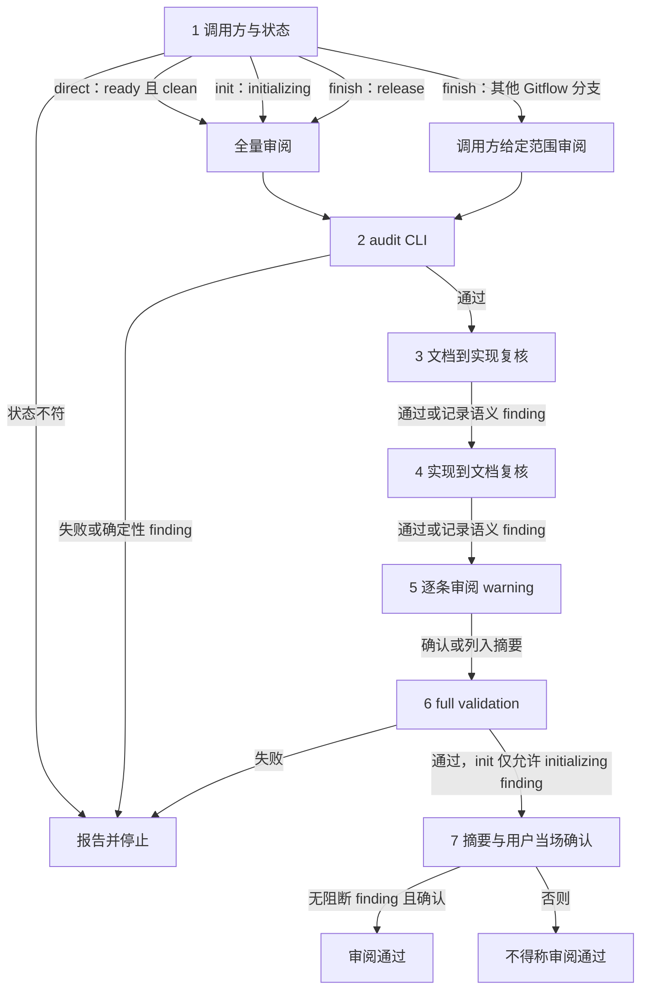

# Audit

它只读：不写入、移动、提交、生成持久报告或执行 `verification.commands`。

## 决策树

## 工作流（唯一执行契约）

完整读取 `intents/common.md` 与 `references/repository-contract.md`。

1. **约束**；确定类型和状态：direct 执行`全量审阅`、manifest 必须 `ready` 且查 clean；
   init 为全量、允许 `initializing` 且不重查 clean；finish 的 release 为全量，
   其他分支为调用方给出实现和当前事实文档范围的范围审阅；证据：调用方与范围；
   通过 → 2；失败 → 停止。
2. **脚本**；调用 `audit` CLI；全量不带路径，范围使用调用方计算的精确路径；
   证据：范围、文档—`evidence` 映射、ignore 匹配、warnings、确定性 findings；
   通过 → 3；失败 → 调用失败或有确定性 finding 时停止。
3. **约束**；从文档到实现执行`事实复核`：复核范围内每份当前事实文档、陈述和 `evidence`；
   证据：事实复核；通过 → 4；失败 → 记录语义 finding 后继续 4。
4. **约束**；从实现到文档复核产品行为、系统边界、架构、接口、数据与运维实现；
   证据：未记录实现、过时/错误陈述、不可验证 evidence 与计划混写 findings；
   通过 → 5；失败 → 记录语义 finding 后继续 5。
5. **约束**；逐条审阅 CLI warning；证据：未被 evidence 引用且未被 ignorelist 覆盖的
   实现文件及用户当场确认；通过 → 6；失败 → 列入会话摘要后继续 6。
6. **脚本**；运行 `full validation`，不运行验证命令；init 只允许
   `manifest.initializing` finding；证据：validation findings；通过 → 7；
   失败 → 报告并停止。
7. **约束**；返回审阅类型、两类范围、映射、warnings、复核文档、语义/validation
   findings 与未触及理由；证据：会话摘要和用户当场确认；通过 → 无语义 finding、
   无未确认 warning，且 validation 无 finding 时通过；
   init 仅豁免 `manifest.initializing`，不得将其计为阻断 finding；
   失败 → 不得称审阅通过。该确认不跨调用复用。

Audit 不检查 Gitflow 分支、变更 diff、Proposal、Bug、Change、release 输入、closeout 或
merge 条件；这些属于 `$mdf finish` 的交付前检查。

## 术语与数据结构

### 审阅类型

- `全量审阅`：从文档和实现两个方向覆盖全部当前事实文档与实现面。
- `范围审阅`：从文档和实现两个方向覆盖调用方给定的实现与文档范围。
