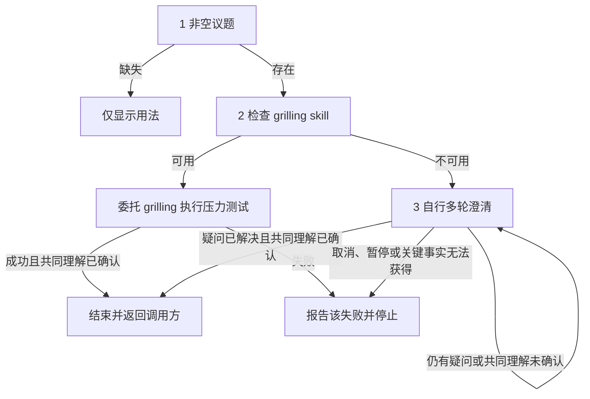

# Clarify

## 决策树

## 工作流（唯一执行契约）

1. **约束**；要求非空议题；证据：用户提供的议题；通过 → 2；失败 → 仅显示用法。
2. **约束**；检查当前宿主是否提供系统 `grilling` skill；可用时完整读取并委托它对议题执行压力测试；
   证据：可用性检查、该 skill 的流程结果与共同理解确认；通过 → 可用且完成时结束并返回调用方，
   不可用时进入 3；失败 → 委托执行失败时报告该失败并停止，不静默改走自问流程。
3. **约束**；自行查证仓库可回答的事实，列出议题的未决问题与依赖；每轮向用户询问
   当前能够回答的问题并给出建议，等待回答后更新已确认决定与剩余疑问，再继续下一轮。
   调用方要求一次一个问题时遵守该限制；不得把未回答视为同意。疑问解答完毕后，
   总结目标、范围、关键取舍与排除项，要求用户确认共同理解；证据：问题、回答、
   决定、无未决疑问及用户明确确认；通过 → 结束并返回调用方；失败 → 有新疑问或
   共同理解未确认时继续 3；用户取消、暂停或关键事实无法获得时列出未决项并停止。
