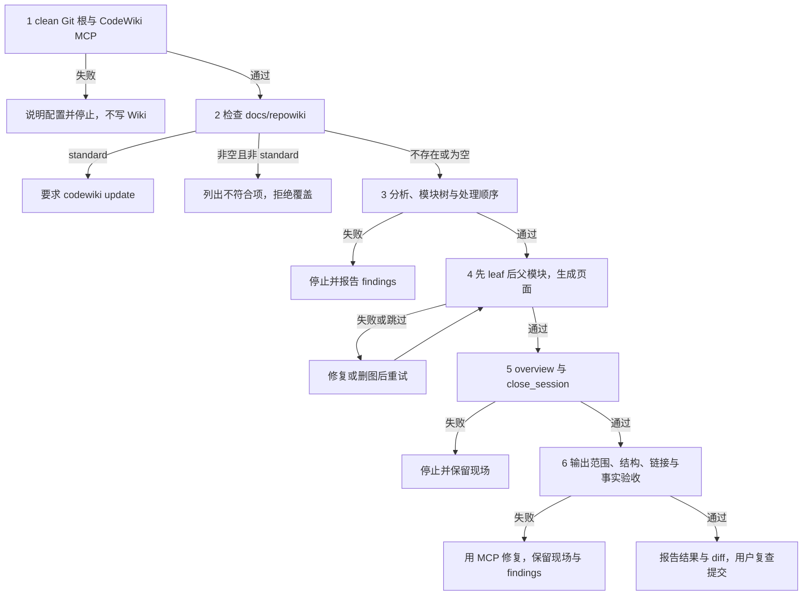

# CodeWiki Generate

不要求已初始化 `.mdf/manifest.yaml`。

## 决策树

## 工作流（唯一执行契约）

完整读取 `intents/common.md` 与 `references/codewiki-contract.md`。

1. **约束**；解析目标 Git 根 `REPO_ROOT` 并在外层检查 clean；检查 CodeWiki MCP；
   证据：Git 根、clean 与 MCP 可用；通过 → 2；失败 → 按契约给出安装和 MCP 配置后停止，
   不写 `docs/repowiki/`。
2. **约束**；检查 `docs/repowiki/`：不存在或为空才可生成；证据：目录状态；
   通过 → 3；失败 → standard 时要求 `$mdf codewiki update`，非空非 standard 时列出
   不符合项并停止。用户可移至自选非受管位置后重调；旧材料只作 reference，代码优先。
3. **脚本**；调用 `analyze_repo`，固定 repo/output 路径，遵守 `.gitignore` 并按实际
   排除第三方和纯生成目录；读取 workspace 的四个 JSON、`get_prompt(cluster)` 与
   所需 `read_code_components`；按内聚、调用与目录边界聚类，使用原始 component ID
   调用 `save_module_tree` 并读取 `processing_order.json`；小仓库不强造层级，大仓库
   避免只按目录机械切分；证据：模块树和处理顺序；
   通过 → 4；失败 → 停止并报告 findings。
4. **脚本**；按 processing order 先 leaf 后父模块；每页先 `get_prompt`，读取相关组件
   和必要文件，再用 `write_doc_file` 写入受管 marker、可证当前事实、职责、关系、边界
   与链接；证据：模块页与 Mermaid 校验；通过 → 5；失败 → 失败或跳过时修复或删图后重试。
   对可读疑点追踪至事实；仓外事项省略或标为“不覆盖”；不得遗留 TODO、待确认或猜测。
   主动查找符合定义的 hack；存在才写 `hacks.md`，不得将项目特定版本、迁移或路由
   分层抽象成通用 hack 规则。
5. **脚本**；写入带受管 marker 的 `overview.md`，包含入口、地图、主要关系、阅读顺序
   及全部模块/hacks 链接；调用 `close_session`；证据：至少一页 Markdown 写入后的
   `metadata.json` 基线；通过 → 6；失败 → 停止并保留现场。
6. **约束**；验收本次改动仅在 `docs/repowiki/`，overview、模块页、三个 JSON、链接、
   模块树和 metadata 均有效且 `.codewiki/` 无仓库改动；抽样回读并对照代码确认简体
   中文、事实闭合、无占位，且所有 hack 符合定义；证据：验证与 diff；通过 → 报告模块数、
   页面、hack 数、变更基线、验证结果和 diff，提醒用户复查提交；失败 → 用 MCP 修复，
   保留失败现场和 findings。
