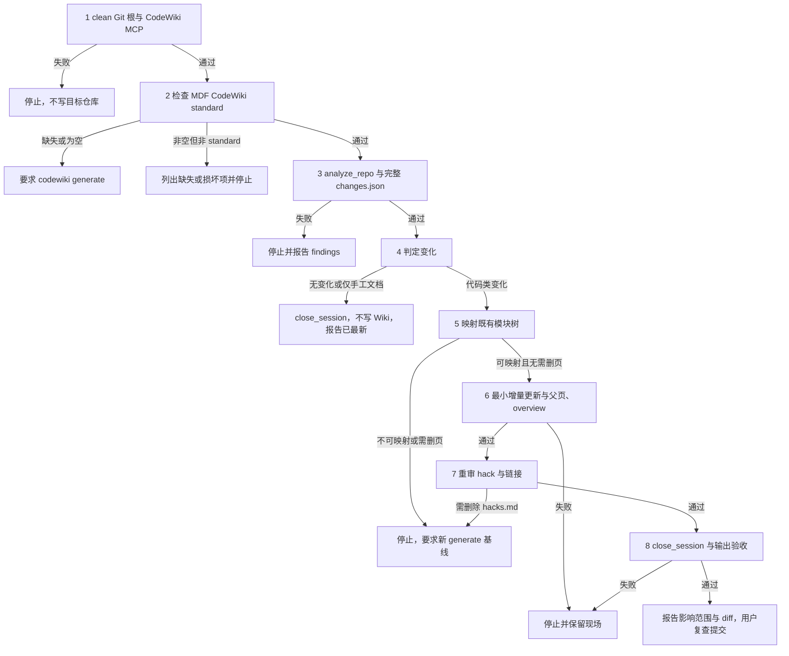

# CodeWiki Update

不要求已初始化 `.mdf/manifest.yaml`。

## 决策树

## 工作流（唯一执行契约）

完整读取 `intents/common.md` 与 `references/codewiki-contract.md`。

1. **约束**；解析 `REPO_ROOT`、在外层检查 clean，并检查 CodeWiki MCP；证据：Git 根、
   clean、MCP；通过 → 2；失败 → 按契约给出安装和 MCP 配置后停止，不写目标仓库。
2. **约束**；按契约检查 `docs/repowiki/`；证据：MDF CodeWiki standard；
   通过 → 3；失败 → 目录缺失或为空时要求 `$mdf codewiki generate`；非空但不 standard 时
   列出缺失/损坏项并停止，不调用 `analyze_repo`、不写入、不尝试修复。旧 Wiki 只可在
   用户移出受管根后作为只读 reference。
3. **脚本**；调用 `analyze_repo`，固定 `repo_path` 为 `REPO_ROOT`，`output_dir` 为
   `REPO_ROOT/docs/repowiki`；读取返回的 `changes` 与 workspace 的完整 `changes.json`；
   证据：变更分类；通过 → 4；失败 → 停止。
4. **约束**；`no_changes: true` 或仅手工文档变化时调用 `close_session`，不写 Wiki；
   证据：无代码、配置、schema、测试或已跟踪生成物变化；通过 → 报告已最新并结束；
   失败 → 5。
5. **约束**；确认变化可映射到既有 `module_tree.json`，且不需删受管页；
   证据：affected/cascade modules；通过 → 6；失败 → 停止并要求新 generate 基线。
   MCP-only 契约不得用 shell 或编辑器删除、重排或补写受管 Wiki。
6. **脚本**；为 affected modules 读取源码与关联文件，以 `edit_doc_file` 最小修订，
   只有新页用 `write_doc_file`；随后刷新 cascade 父页，最后更新 overview 的地图、
   关系和链接；证据：仅受影响的写入文件；通过 → 7；失败 → 停止并保留现场。
7. **脚本**；重审 hack：无页时 `write_doc_file`，有页时 `edit_doc_file`；首次新建时
   同步在 `overview.md` 加入链接；证据：hack 与 overview 一致；通过 → 8；失败 → 需删整个
   `hacks.md` 时停止并要求新基线。保持受管 marker、简体中文、可证事实与 Mermaid 验证；
   仓外事项省略或标明不覆盖。
8. **脚本**；调用 `close_session`；验收仅改 `docs/repowiki/`，受影响/级联页、overview、
   链接、模块树、metadata 一致，`.codewiki/` 无仓库改动，无 TODO、待确认或未验证图；
   抽样对照变更前后代码；证据：更新基线、验证和 diff；通过 → 报告检测方法、影响/级联
   模块、写入文件、hack 变化、验证和 diff，提醒用户复查提交；失败 → 停止并报告。
