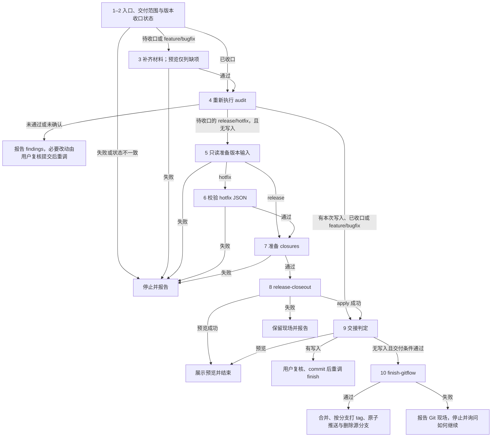

# Finish

用户要求预览时全程只读；不补写文档、不移动 Change、不修改对象、不执行验证命令，
不合并、打 tag、push 或删除分支。缺少预览输入时报告缺项并停止。

## 决策树

## 工作流（唯一执行契约）

完整读取 `intents/common.md`、`intents/audit.md`、
`references/repository-contract.md` 与 `references/object-contract.md`。

### 交付前检查

1. **脚本**；解析目标 Git 根为 `REPO_ROOT`，运行 `doctor` 与 `branch`；
   证据：manifest `ready`、非 detached、clean，
   Gitflow 分支为 `feature/*`、`bugfix/*`、`release/<semver>` 或 `hotfix/<semver>`，
   以及用户是否要求预览；通过 → 2；失败 → 停止。
2. **约束**；写入前计算交付范围：feature/bugfix 为 `develop...HEAD`，hotfix 为
   `master...HEAD`；release 要求本地 develop，以当前 checkout 和全部 child Change 为交付范围。
   检查代码、配置、schema、测试、当前事实、Proposal、Bug、Change，识别应更新文档。
   release/hotfix 同时检查 `changes/<version>/CHANGE.md` 与 manifest：版本根不存在，
   且 latest_release 为 null 或按稳定 SemVer 比较小于目标版本时，判为待收口。
   版本根已跟踪、已提交，且 version、
   change_kind、source_branch 与当前分支完全一致、latest_release 等于目标版本时，
   运行 full validation 并核对版本根证据仍覆盖当前交付结果；通过才判为已收口。
   版本根提交后有未纳入收口的交付改动、记录缺损或状态不一致时停止，不覆盖版本目录；
   证据：精确实现与文档路径、版本状态及校验结果；通过 → 待收口或 feature/bugfix 到 3，
   已收口到 4；失败 → 报告缺项或不一致并停止。这是交付前检查，不是 audit。
3. **约束**；补齐步骤 2 识别的必要当前事实；feature/bugfix 同时补齐 child Change，
   不建版本目录，不关闭对象，Proposal 保持 ready，Bug 按对象契约记录状态。
   迁入既有材料时要求用户确认来源目录、目标 `changes/unreleased/<slug>` 与链接重写；
   源 slug 须等于分支 slug 且不得含符号链接；目标冲突、来源含有目标或非 canonical
   `CHANGE.md` 时停止；迁移只可用 `move-change`，无材料时创建最小 Change 目录。
   release/hotfix 不在此移动 child Change。预览仅列待补材料，不写入；
   证据：确认的来源、合法路径、当前事实与 child Change，或预览缺项清单；通过 → 4；
   失败 → 保留现场并报告；预览缺少必要材料时停止。
4. **约束**；内部委托 `audit`：release 执行`全量审阅`，其他分支仅审阅步骤 2 的精确范围；
   每次续办都重新审阅，不复用上次语义确认；证据：零 finding、用户当场确认 warning 和语义摘要；
   通过 → 本次已有写入、已收口或 feature/bugfix 到 9；其余 release/hotfix 到 5；
   失败 → 报告并停止；非预览可修复文档，要求用户复核、commit 后重调 finish。
5. **约束**；只读准备收口输入：release 读取全部 unreleased child Change，移动留给第 8 步 CLI；
   hotfix 必须没有 child Change，且提供实际结果 JSON；两者均提供规范 `--release-date`，
   仅用户要求预览时加 `--dry-run`；证据：完整版本收口输入；通过 → release 到 7，
   hotfix 到 6；失败 → 停止。Core 记录确定性审计，语义审阅使用本次已确认 audit。
6. **约束**；校验 hotfix `--hotfix-change-json`：必填 body、release_notes、evidence；
   可选 proposals、fixed、closed、deferred、adrs、breaking。body 非空，三类 evidence
   字符串列表合计至少一条，release notes 至少一项非空；证据：有效 JSON；通过 → 7；
   失败 → 未知字段、空字符串或缺字段时停止。Core 注入 change_kind 与 source_branch。
7. **约束**；准备 `--closures-json`，覆盖每个 child Change outcome，并可补录未写 child
   Change 的对象；本步不写对象。对每个 active 且 `found_in: unreleased` 的 Bug 分类：
   fixed 经二次验证后由 CLI 关闭并写 fixed_in，rejected 使用既有 reject-reason，
   deferred 保持 open；critical 仅 fixed；major deferred/wont-fix 要用户接受、理由和 follow-up；
   duplicate 不进 outcome，canonical 与 duplicate 一并归档；证据：完整 closures 与验证、
   接受记录；通过 → 8；失败 → 停止。
8. **脚本**；调用 `release-closeout`；版本根 Change 聚合 child outcomes/evidence，
   evidence 按首次出现顺序去重并追加 manifest 验证命令。apply 在目标仓库执行命令，
   保持 clean 后写入；preview 不执行命令、不写入；证据：CLI 结果，apply 的命令结果和 clean，
   或 preview 的只读摘要；通过 → preview 展示结果后结束，不进入 9 或 10；apply 到 9；
   失败 → 保留现场供用户检查。
9. **约束**；交接本次结果：预览只展示摘要并结束；本次有工作区改动时展示 diff 与验证结果，
   要求用户复核、commit 后重调。无写入的 release/hotfix 必须满足第 2 步已收口判定，
   且第 4 步本次 audit 通过；feature/bugfix 必须完成 child Change 与本次 audit；
   证据：已提交的复查结果、当前 clean 与交付条件；通过 → 非预览且无写入时到 10；
   失败 → 报告未满足条件并停止，不执行 Git 收口。
10. **脚本**；调用 `finish-gitflow --repo "$REPO_ROOT"`。CLI fetch 后要求源分支及参与的
    master/develop 与 upstream 完全一致；feature/bugfix no-ff 合并到 develop；
    release/hotfix no-ff 合并到 master 后 no-ff 合并 master 到 develop，并创建注释
    `v<semver>` tag；仅这些合并自动创建 merge commit。随后原子 push、删远端及本地源分支；
    证据：合并、tag 和推送结果；通过 → 结束；失败 → 停止并报告当前分支、已完成合并、
    tag 与推送状态；冲突时 CLI abort 当前 merge，但不得声称此前已完成的合并也被回退。
    不继续推送或删分支，询问用户如何继续；必要修复仍须复核、commit 后重调。
