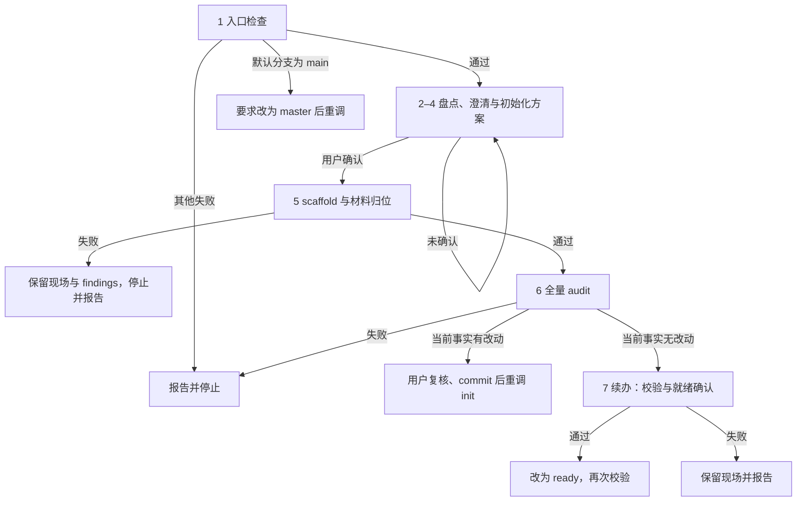

# Init

它将既有材料收敛到当前 MDF 结构，经`当前事实文档`的事实复核后使 `manifest` 进入 `ready`。

## 决策树

## 工作流（唯一执行契约）

完整读取 `intents/common.md`、`intents/clarify.md` 与
`references/repository-contract.md`。

### 1. 入口检查

1. **脚本**；在外层确认 clean、解析 Git 根 `REPO_ROOT` 并运行 `doctor`；检查默认
   分支；证据：clean、doctor 与默认分支；通过 → 2；失败 → 默认 `main` 时要求用户先
   改为 `master`，其他 finding 报告后停止。中间反馈继续本次流程，不重查入口。

### 2. 盘点与归类

2. **约束**；盘点全部顶层项目项并检查项目原有的全部文档，区分 MDF 固定项、治理/生态入口、实现、测试、
   生成物与文档；证据：分类清单；通过 → 3；失败 → 停止并澄清。不得仅凭目录名或 README
   保留；符合 CodeWiki 契约的 `docs/repowiki/` 留在原处且不纳入当前事实、ADR 或调研分类；
   此步骤不做`事实复核`。
3. **约束**；对每个非生态必需且非 MDF 固定的顶层目录，使用内部 clarify intent
   决定去处或顶层例外；本地或外部调研材料归入 `context/research/`，已确认决策归入
   `docs/adr/`，并从
   仓库证据收敛八项 `基线`、最近稳定版本与非空 `verification.commands`；
   证据：逐项决定与验证命令；通过 → 4；失败 → 无法分类时一次只问一个问题。
   仅含 `.gitkeep` 的占位目录按其未来职责迁移；迁移目标已有实际内容时，
   在同一方案中移除 `.gitkeep`，否则保留。业务实现目录和测试目录建议迁入
   `src/<目录>`/`tests/<目录>`，但不得在未经确认时迁移或删除。无业务检查的空仓库建议
   使用 `git diff --check`；从未发布时最近稳定版本为 `none`。
4. **约束**；形成`初始化方案`：路径、材料去处、保留内容、顶层允许清单、实现/测试目录、
   拟补字段、基线、验证命令与预期 `validation`；证据：用户明确确认；通过 → 5；
   失败 → 材料分类有误时回到 2；去处、基线或验证命令需调整时回到 3。
   移动/删除必须列出源、目标和无信息损失理由，且不得覆盖既有内容。
   不处理待实现意图；完成后用户可按输入形态显式 `$mdf intake` 或
   `$mdf bug create` 或 `$mdf prp create`。配置调整必须再次显式调用 `$mdf init`。

### 3. 落地初始化方案

5. **脚本**；执行 `init` 建立完整 scaffold，保持 manifest `initializing`，写入确认的
   验证命令，并只按方案归位/保留/排除原材料与顶层项；证据：固定布局、完整归位核对表、
   `README.md`、`PROJECT.md`、`AGENTS.md` 与 `GLOSSARY.md` 各自符合`根文档职责`
   且入口可达、没有未说明的遗留文件；通过 → 6；失败 → 保留现场与 findings，不自动回退；停止并报告。项目原有文档
   与经确认迁移的顶层项目项只可按方案归位、保留或排除；保留 `AGENTS.md` 非 MDF
   托管块；完成当前事实文档、ADR、`README.md`、`PROJECT.md` 与验证命令；在
   `PROJECT.md` 记录仅含例外的顶层允许清单与目录约定。方案调整仓库结构时，审视
   `README.md` 的用户/维护入口、`PROJECT.md` 的维护手册与当前事实文档，消除重复。

### 4. 审计当前事实

6. **约束**；比较调用前后的 `GLOSSARY.md`、`docs/product/**` 与
   `docs/system/**`，内部委托 `audit` 执行`全量审阅`；证据：事实复核、diff 与 full validation；
   通过 → 当前事实有改动时展示结果并停止，要求用户复核、commit 后重调 init；无改动时 7；
   失败 → 仅允许 `manifest.initializing` finding，其他 finding 报告并停止。

### 5. 续办

7. **脚本**；续办时不得改当前事实，运行 full validation；展示当前事实复核、八项基线和
   `verification.commands` 核对表；证据：只剩 initializing finding 与用户明确“结束初始化
   并启用正常工作流”确认；通过 → 改为 `ready` 并再次 full validation 后结束；
   失败 → 保留现场并报告。即使未改当前事实，也须满足八项基线和非空命令并取得确认。
