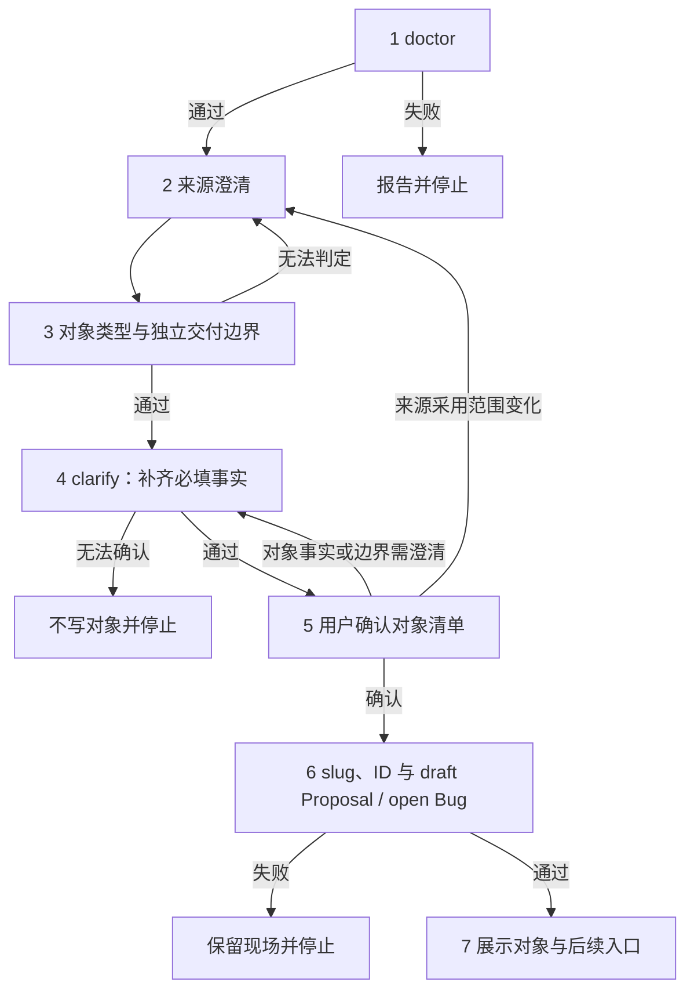

# Intake

## 决策树

## 工作流（唯一执行契约）

完整读取 `intents/common.md`、`intents/clarify.md`、
`references/repository-contract.md` 与 `references/object-contract.md`。

1. **脚本**；解析 `REPO_ROOT` 并运行 `doctor`；证据：
   `normal_workflows_allowed: true`；通过 → 2；失败 → manifest 未就绪时提示
   `$mdf init`，其他 findings 报告后停止。
2. **约束**；接收一句话、当前聊天上下文或外部文档为一次性来源；一次只问一个问题，
   确认范围、关键事实与取舍；除非用户明确要求保留，不得复制、归档或链接到仓库；
   证据：确认的来源采用范围；通过 → 3；失败 → 等待澄清。
3. **约束**；从来源和仓库证据判定对象类型、数量与独立交付边界；偏差建 Bug，
   待实现意图建一个或多个 Proposal；证据：对象清单；通过 → 4；失败 → 回到 2。
4. **约束**；使用内部 clarify intent 按轮次澄清成稿必要事实；Proposal 收敛 Problem、
   Desired Outcome、Scope、可验证 Acceptance Criteria；Bug 收敛 Observed/Expected
   Behavior、Reproduction、Impact、Regression Evidence Required、`found_in` 与 active
   severity；证据：完整必填事实；通过 → 5；失败 → 必填事实仍无法确认时停止，不得写入任何对象。
5. **约束**；展示对象清单、边界、排除范围、Proposal 依赖；`depends_on` 仅列直接依赖
   的 draft、ready 或 closed + fulfilled Proposal ID；证据：只有用户明确确认清单才继续；
   通过 → 6；失败 → 来源采用范围变化时回到 2；对象必填事实或边界需澄清时回到 4。
6. **脚本**；为每项提议并确认英文 ASCII kebab-case slug，按类型 proposal 或 bug
   使用 `make-id --type <type> --slug <slug>`
   生成 ID 与规范化文件名，并以模板写入 `proposals/` 或 `bugs/`；Proposal 初始状态为
   `draft`，Bug 初始状态为 `open`；证据：所有新建对象；通过 → 7；失败 → 停止并保留现场。
7. **约束**；展示新建对象、确认事实、排除范围和依赖；证据：会话摘要；通过 → 结束；
   失败 → 停止。Proposal 后续显式调用 `$mdf prp review`，经 draft targeted validation 后转为
   `ready`；Bug 创建后即为 `open`，不得关闭普通对象或填写 `fulfilled_in`/`fixed_in`。
