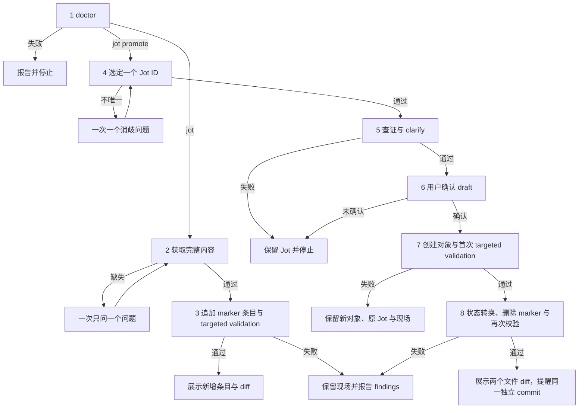

# Jot

`$mdf jot` 追加一条 Jot；`$mdf jot promote` 提升一条既有 Jot；不接受其他子动作。

## 决策树

## 工作流（唯一执行契约）

完整读取 `intents/common.md`、`intents/clarify.md`、
`references/repository-contract.md` 与 `references/object-contract.md`。

1. **脚本**；解析 `REPO_ROOT` 并运行 `doctor`；证据：
   `normal_workflows_allowed: true`；通过 → 按调用进入 2 或 4；失败 → manifest 未就绪时
   提示 `$mdf init`，其他 findings 报告后停止。同次仅处理一个 Jot，且保留其原文。
2. **约束**；仅对裸 `$mdf jot` 要求用户提供内容；证据：完整输入；通过 → 3；
   失败 → 一次只问一个问题。内容可为任何未定性信息，不要求预判类型、优先级或可行性。
3. **脚本**；调用 `make-jot-id`、生成简短标题、在 `JOTS.md` 末尾追加完整 marker 条目，
   保留原始含义和细节，再运行 `targeted validation`；证据：新增条目和 diff；
   通过 → 结束；失败 → 保留现场并报告 findings。
4. **约束**；仅对 `$mdf jot promote` 要求一个既有 `jot-` ID，读取完整 marker；
   证据：唯一条目与其正文；通过 → 5；失败 → 一次只问一个消歧问题。
5. **约束**；先查仓库证据，使用内部 clarify intent 按轮次将正文收敛为 Proposal 或 Bug；
   Proposal 收敛 Problem、Desired Outcome、Scope、可验证 Acceptance Criteria；
   Bug 收敛
   Observed/Expected Behavior、Reproduction、Impact、Regression Evidence Required、
   `found_in` 与 active severity；证据：完整 draft；通过 → 6；失败 → 停止，不得改写 Jot。
6. **约束**；展示 draft、确认事实与排除范围，并要求用户明确确认；证据：确认；
   通过 → 7；失败 → 停止，保留 Jot。
7. **脚本**；提议并确认英文 ASCII kebab-case slug；按对象类型 proposal 或 bug，
   调用 `make-id --type <type> --slug <slug>`；
   Proposal 写为 `draft`，Bug 写为 `open`，运行 `targeted validation`；证据：
   新对象与首次 validation；通过 → 8；失败 → 保留新对象、原 Jot 与现场，并报告 findings。
8. **脚本**；Proposal 转为 `ready`；Bug 保持 `open`。删除选中 Jot marker，
   再运行 `targeted validation`；
   证据：两个文件完整 diff 与两次验证；通过 → 结束；失败 → 保留现场并报告 findings。
   成功时提醒用户将创建与移除作为同一个独立 commit；绝不自动 commit。
