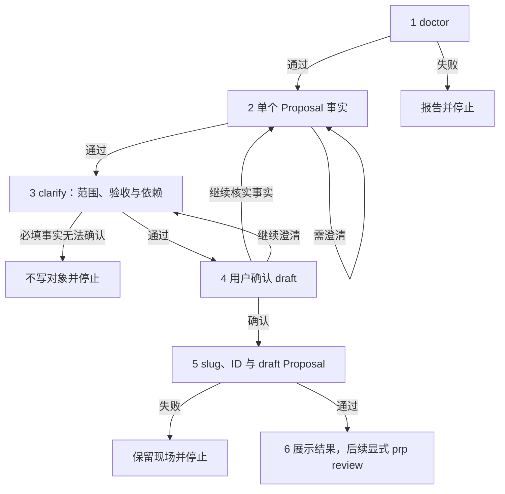

# PRP Create

## 决策树

## 工作流（唯一执行契约）

完整读取 `intents/common.md`、`intents/clarify.md`、
`references/repository-contract.md` 与 `references/object-contract.md`。

1. **脚本**；解析 `REPO_ROOT` 并运行 `doctor`；证据：
   `normal_workflows_allowed: true`；通过 → 2；失败 → manifest 未就绪时提示
   `$mdf init`，其他 findings 报告后停止。
2. **约束**；接收用户手动提供的单个 Proposal 事实；一次不得创建多个对象；一次只问一个
   问题，澄清范围、关键事实与取舍。外部想法、当前聊天上下文或外部文档必须显式调用
   `$mdf intake`；证据：
   确认的 Proposal 与采用范围；通过 → 3；失败 → 等待澄清。
3. **约束**；使用内部 clarify intent 按轮次澄清 Problem、Desired Outcome、Scope、可验证
   Acceptance Criteria 与直接依赖；证据：完整必填事实；通过 → 4；失败 → 必填事实仍无法
   确认时停止，不得写入任何对象。
4. **约束**；展示 Proposal、边界、排除范围和依赖；`depends_on` 仅列直接依赖的 draft、
   ready 或 closed + fulfilled Proposal ID；证据：只有用户明确确认 draft 才继续；通过 → 5；
   失败 → 输入对象或来源变化时回到 2；既定对象的事实、范围或验收需澄清时回到 3。
5. **脚本**；为 Proposal 提议并确认英文 ASCII kebab-case slug，使用
   `make-id --type proposal --slug` 生成 ID 与规范化文件名，并以模板写入 `proposals/`，
   初始状态为 `draft`；证据：draft Proposal；通过 → 6；失败 → 停止并保留现场。
6. **约束**；展示 draft Proposal、确认事实、排除范围和依赖；证据：会话摘要；通过 → 结束；
   失败 → 停止。后续显式调用 `$mdf prp review`，经 draft targeted validation 后转为 `ready`；
   不得关闭普通对象或填写 `fulfilled_in`。
