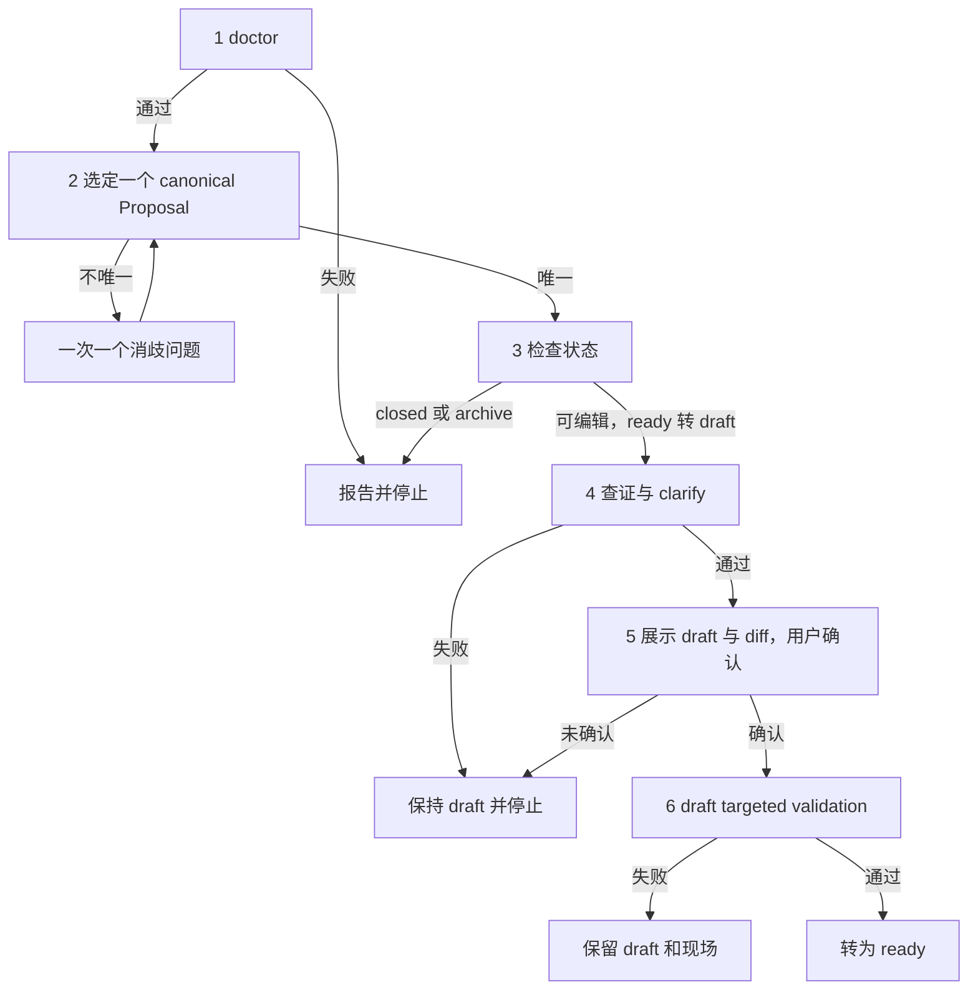

# PRP Review

## 决策树

## 工作流（唯一执行契约）

完整读取 `intents/common.md`、`intents/clarify.md`、
`references/repository-contract.md` 与 `references/object-contract.md`。

1. **脚本**；解析 `REPO_ROOT` 并运行 `doctor`；证据：
   `normal_workflows_allowed: true`；通过 → 2；失败 → manifest 未就绪时提示
   `$mdf init`，其他 findings 报告后停止。
2. **约束**；一次只接受一个 Proposal 的 canonical `prp-` ID 或仓库相对路径；证据：
   唯一对象；通过 → 3；失败 → 一次只问一个消歧问题。
3. **约束**；closed 或 archive Proposal 拒绝修改；开始评审时将既有 `ready` 转为 `draft`；
   取消、暂停或未确认时保持 `draft`；证据：对象状态；通过 → 4；失败 → 停止。
4. **约束**；先查仓库证据，使用内部 clarify intent 按轮次澄清 Problem、Desired Outcome、
   Scope 与可验证 Acceptance Criteria；证据：完整 draft；通过 → 5；失败 → 保持 draft 并停止。
5. **约束**；展示 draft、确认事实、排除范围和既有对象 diff；证据：用户明确确认；通过 → 6；
   失败 → 保持 draft，用户可在 commit 后的后续调用继续。只有用户明确确认才转 `ready`。
6. **脚本**；先在 `draft` 状态运行 `targeted validation`，通过后转为 `ready`；证据：
   validation 通过；通过 → 结束；失败 → 保留 draft 和现场。不得关闭对象或填写 `fulfilled_in`。
