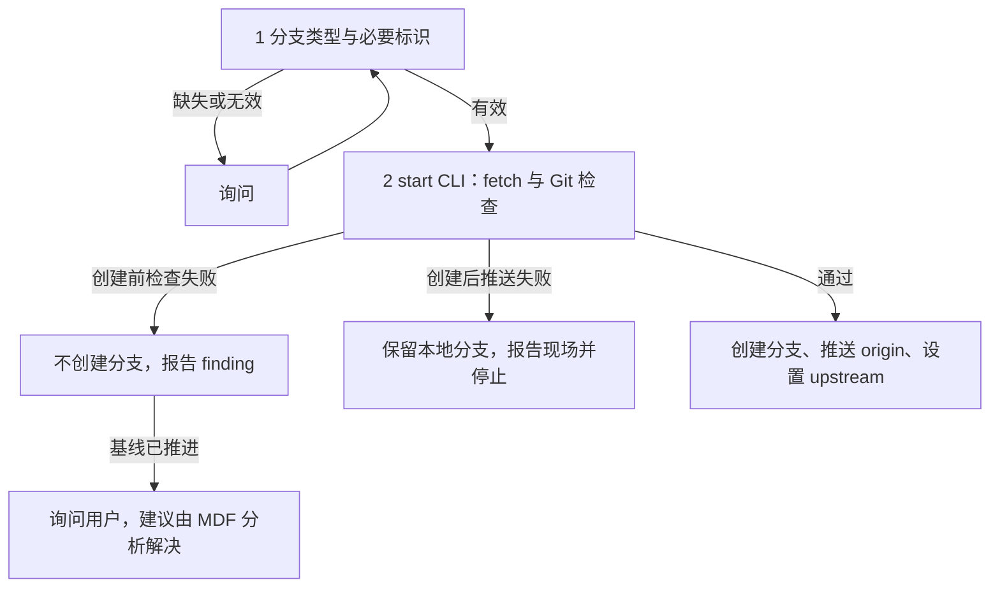

# Start

一次只启动一个分支。

## 决策树

## 工作流（唯一执行契约）

完整读取 `intents/common.md`。

1. **约束**；一次只要求一个分支的类型和必要标识：feature/bugfix 要 slug，
   release/hotfix 要稳定 SemVer；证据：明确参数；通过 → 2；失败 → 询问。
   不得从自然语言猜测版本。
2. **脚本**；解析目标 Git 根为 `REPO_ROOT`；运行 `start --repo "$REPO_ROOT" --kind <kind>`，
   feature/bugfix 使用
   `--name <slug>`，release/hotfix 使用 `--version <semver>`；CLI 在同一次调用中 fetch，
   检查 `origin`、默认 `master`、来源及 upstream 一致、clean、目标不存在，再从 develop
   创建 feature/bugfix/release 或从 master 创建 hotfix、推送到 origin 并设置 upstream；
   证据：检查、分支、远端与 upstream；通过 → 结束；失败 → 创建前检查失败时不创建
   分支并报告 finding；创建后推送失败时保留本地分支，报告 CLI 返回的现场，
   不自动删分支或重试 start。先核对远端分支与本地 HEAD，再按用户选择补推或处理现场；
   基线已推进时先询问用户并建议由 MDF 分析解决。绝不自动 commit。
